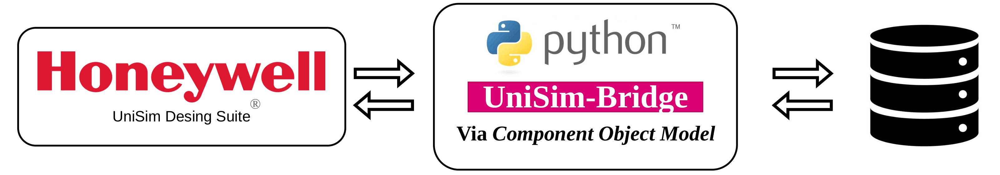

# UniSim Connector

The **UniSim-Bridge** is a Python framework developed by the **PROTEC group** of the [Polytechnic School of the Federal University of Bahia](https://eng.ufba.br/) to automate Honeywell&trade; UniSim Design Suite&reg; simulations through the Microsoft COM (Component Object Model) protocol.

It allows you to:

- Open and manipulate a UniSim Desing Suite&reg; `.usc` case.
- Advance the dynamic solver in discrete time steps.
- Inject disturbances or setpoint changes at specific steps into the simulation equipment or into spreadsheets — also known in UniSim's object model as **[Operations](#what-are-operations)**.
- Persist selected stream, operation, and controller data to a SQLite database.

## Current Structure

The framework is currently composed of three main files:

- **`setup_subsep.py`**: Configuration. You edit this to tell the tool which simulation file to open and which operations to track.
- **`main.py`**: The execution script. It loads the setup, runs the simulation loop, and handles cleanup.
- **`UnisimConnector.py`**: The core library. It handles the COM communication, database writing, and object management.

## Who is this for?

This is for colleagues who are already using the 3-file framework and need a reference for how it works or how to make changes without breaking it.

## What are Operations?

In UniSim Design Suite&reg;, an **operation** is `an object that represents a type of equipment in the flowsheet`. Valves, compressors, heat exchangers, flash tanks, controllers, pipe segments, heaters, coolers, and spreadsheets. Each operation exposes a set of properties, such as `ActuatorPosition`, `Pressure`, or `MassFlow`, which can be read and written through the COM interface.

Throughout this documentation, when we say **"operation"**, we mean *any equipment UniSim exposes on its `Flowsheet.Operations` collection*. The `UnisimConnector.py` file groups these into Python classes (`Valves`, `Controllers`, `Compressors`, etc.) derived from the `Operation superClass`, these classes cache the COM objects   , record the selected properties at every time step, and persist them to the database. 

Full details, class mapping, and the complete list of tracked operation types available in **[Operations Reference](reference/operations-reference.md)**

## Navigating UniSim's COM Object Tree

Everything the connector does is a consequence of walking UniSim's COM tree. If you know how to navigate it, you can inspect and modify any object UniSim exposes. See **[Navigating the COM Object Tree](reference/com-navigation.md)** for the full guide — it covers `dir()`, how to discover properties, and how material streams and subflowsheets are reached.

Start with [Installation](getting-started/installation.md) or jump straight to [First Simulation](getting-started/first-simulation.md).