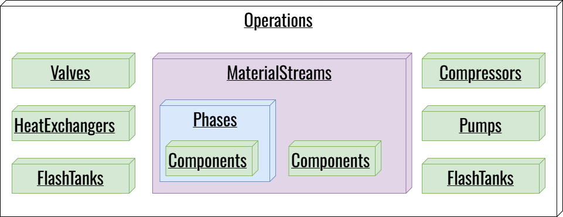

# Operations
## How UniSim-Bridge represents operations

UniSim-Bridge wraps each operation type in a Python class derived from `Operation`. These classes **cache** the COM objects, **record** selected properties at every time step, and **upload** the values to the SQLite database. 

The base class lives in [`UnisimConnector.py`](../files/unisim-connector.md) as `Operation`. Each subclass (e.g., `Valves`, `Controllers`) only has to declare two things:
1. Its `_operation_title` (which matches UniSim's `TypeName`).
2. Its default `properties` dictionary (which properties to read and in what units).

## The `Operation` Base Class

Because all operation classes inherit from the base `Operation` class, understanding the base class means understanding how every piece of tracked equipment behaves.

### 1. Tracking the Configuration (`names`)
When `easy_setup()` runs, it populates the `_names` list. You can interact with this list using the `.names` property. The setter extends the list, allowing you to add new targets programmatically. It removes duplicates via sets before assigning.

### 2. Building and Validating Objects (`_build_object`)
Before data can be collected, `_build_object()` must find the actual UniSim COM objects. It does this by:
- Checking the main flowsheet's `Operations` collection.
- Checking any requested subflowsheets.
- Verifying the object's `TypeName` matches the class's `_operation_title`. 
- Storing the valid COM objects in the `self.objects` dictionary.

If an object is not found or has the wrong type, it prints a warning (e.g., `'VLV-100' not found in valveop list`) and removes it from the tracking list so it doesn't cause errors later.

### 3. The Performance Cache (`build_properties_cache`)
In COM, fetching a property object (like `valve.ActuatorPosition`) is slow. Doing it every time step for every valve creates a massive bottleneck. 

To solve this, `build_properties_cache()` runs once before the simulation loop. It looks up the COM object for *every* property of *every* tracked item and saves it in a dictionary called `comObjs_properties`. During the time-stepping loop, the code simply calls `.GetValue(unit)` on these pre-fetched objects, resulting in a massive performance improvement (up to 150% faster).

### 4. Data Collection and Persistence (`_update_data` & `_insert_row_to_db`)
At every time step, `_update_data(time)` is called. It loops through the cached properties, reads the current value, and builds a dictionary of the data. 

It then passes this dictionary to `_insert_row_to_db()`, which uses an SQL `INSERT ... ON CONFLICT DO UPDATE` statement. This "upsert" logic means that if a simulation crashes and restarts on the same time step, it will just overwrite the existing row rather than failing or creating duplicates.

### 5. Schema Evolution (`create_operation_table`)
The `create_operation_table()` method handles database initialization. It creates the table based on the properties dictionary. Crucially, if you add a new property to the class in `UnisimConnector.py` later, the method detects that the column is missing from the existing database and uses `ALTER TABLE ADD COLUMN` to safely update the schema without deleting your existing simulation data.

## The `_operation_title` → `TypeName` match

Each subclass sets `_operation_title` to the exact string UniSim uses as an operation's `TypeName`. That's how `_build_object()` knows which entries in `Flowsheet.Operations` belong to which class: it looks up the object, reads its `TypeName`, and rejects it if it doesn't match.

You can inspect this raw mapping for any open simulation case using a simple Python loop:

| `TypeName` (UniSim) | Python class | Default properties |
| :--- | :--- | :--- |
| `materialstream` | `MaterialStreams` | `Pressure`, `Temperature`, `MassFlow`, `VapourFraction` |
| `valveop` | `Valves` | `ActuatorPosition`, `PressureDrop` |
| `compressor` | `Compressors` | `CompressorSpeed`, `AdiabaticEff`, `Energy` |
| `heatexop` | `HeatExchangers` | `Duty` |
| `flashtank` | `Flashtanks` | `VesselPressure`, `VesselTemperature` |
| `fbcontrolop` | `Controllers` | `SP`, `PV`, `OP` |
| `pipeseg` | `Pipesegs` | `PressureDrop` |
| `heaterop` | `Heaters` | `ProductTemperature`, `FeedTemperature` |
| `coolerop` | `Coolers` | `ProductTemperature`, `FeedTemperature` |
| `spreadsheetop` | `Spreadsheets` | (user-defined cells) see how to collect spreadsheet data in |

The full, current property list for each type is on **[Object Properties](properties-reference.md)**.

## Material streams are a special case

`MaterialStreams` is not stored under `Flowsheet.Operations` — it's a parallel collection on `Flowsheet.MaterialStreams`. This is why `setup_subsep.py` has both `MATERIAL_STREAMS` and `OPERATIONS`-style lists: they map to two different UniSim collections, even though they end up in the same SQLite database.

`MaterialStreams` also does more than the other classes: it records bulk stream properties, per-component flows and fractions, and — for streams listed in `MATERIAL_STREAMS_PHASE` — per-phase properties. See [`UnisimConnector.py`](../files/unisim-connector.md#materialstreams) for the class map.

## See also

- **[Navigating the COM Object Tree](com-navigation.md)** — how to walk `Flowsheet.Operations` and `Flowsheet.MaterialStreams` at runtime, and how `dir()` reveals the properties of each operation.
- **[Properties](properties-reference.md)** — every property the framework tracks, per class.
- **[Database Tables](../files/unisim-connector.md#database)** — which SQLite table each operation type writes to.