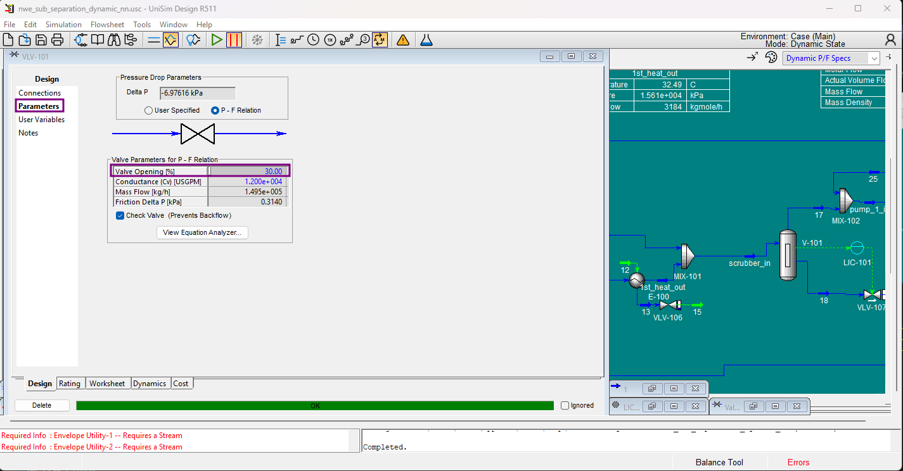
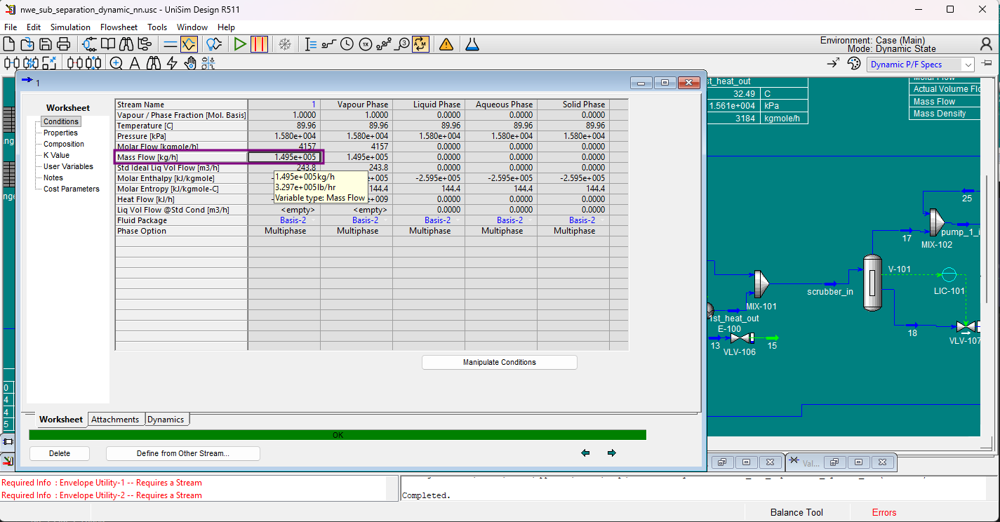

# Finding Properties

Once your simulation is running (using the [minimal template](../getting-started/first-simulation.md#minimal-template)), you will need to know the exact names of the properties you want to track or change.

## Discovering Property Names

Every UniSim object (valves, streams, controllers, etc.) exposes the properties of that family of [Operations](../reference/operations-reference.md). You can use the built-in Python `dir()` function to list them all. 

For example, to see what properties every valve has:

```python
dir(Simulation.valves['VLV-101'])
```

The output is a long list containing every property and method available for Valves:

```python
['ActuatorHasFailed',
 'ActuatorMaximum',
 'ActuatorMaximumValue',
 'ActuatorMinimum',
 'ActuatorMinimumValue',
 'ActuatorMode',
 'ActuatorPosition',
 'ActuatorPositionValue',
 'ActuatorRate',
 'ActuatorRateValue',
 'ActuatorSP',
 ...,
 'PercentOpen' ]
```

You can use the exact string names from this list (like `'PercentOpen'`) to track properties beyond the defaults. To do this, add them to your `main.py` file by [following this guide](../files/main.md#4-adding-properties-that-are-not-recorded-by-default).

## Reading and Writing Values
Once you know the property name, you interact with it using `.GetValue('unit')` and `.SetValue(value, unit)`. For dimensionless values, pass an empty string `''` as the unit.

## Inputs vs. Outputs (Blue vs. Black)
Before trying to change a property via Python, look at it in the UniSim interface:

Blue values are user inputs (specifications). You can change them using `.SetValue(value, 'unit')`.

Black values are calculated outputs. They are read-only. You can read them with `.GetValue(value, 'unit')`, but attempting to `.SetValue()` them will throw a COM error.

### Example: Changing a Writeable Value (Valve)

In the image below, the **Percent Open** field is written in blue. This means it is an input that the simulation uses to calculate the rest of the valve's behavior. You can use Python to override this value dynamically during the run.



```python
# Read the current valve position
Simulation.valves['VLV-101'].PercentOpen.GetValue('')
# Output: 50.0

# Force the valve to 30% open
Simulation.valves['VLV-101'].PercentOpen.SetValue(30, '')

# Verify the change
Simulation.valves['VLV-101'].PercentOpen.GetValue('')
# Output: 30.0
```


### Example: Reading Calculated Values (Stream)

In the image below, the stream properties (like Mass Flow) are written in black. These are the results of the simulation's calculations. You cannot set these directly — if you want to change the mass flow, you must change a blue input elsewhere (like a pump speed or valve position).

However, you can freely read them, and UniSim will automatically convert the units for you based on the string you pass:



```bash
# Get the mass flow in kilograms per hour
Simulation.material_streams['1'].MassFlow.GetValue('kg/h')
# Output: 149542.36856587604

# Get the exact same mass flow, but converted to pounds per hour
Simulation.material_streams['1'].MassFlow.GetValue('lb/hr')
# Output: 329681.10574033036
```

See Also
[Utilities Functions](../reference/utilities-functions.md) — use `get_all_operations()` to discover the names of every object in your case.

[Navigating the COM Object](../reference/com-navigation.md) — how to explore deeper COM objects with `dir()`.